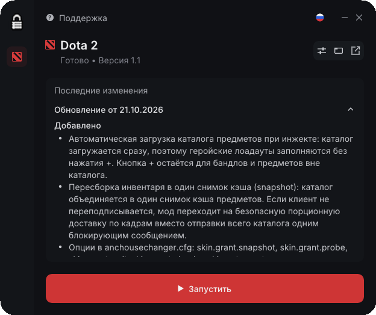
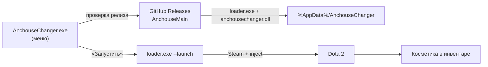
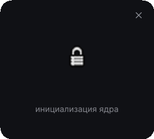
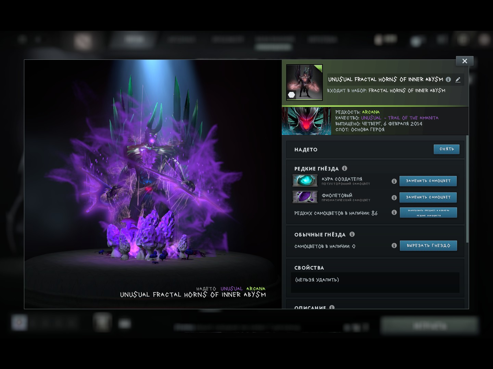

<div align="center">
  
  <h1>AnchouseChanger</h1>
  <p><b>Open-source скинченджер для Dota 2 на Windows</b><br>
  Внешнее меню с автообновлением + внутренний мод, который добавляет косметику прямо в инвентарь.</p>

  <p>
    <a href="https://github.com/Unkn0Wms1337/AnchouseLoader">AnchouseLoader</a> •
    <a href="https://github.com/Unkn0Wms1337/AnchouseMain">AnchouseMain</a> •
    <a href="https://github.com/Unkn0Wms1337/AnchouseMain/releases">Releases</a> •
    <a href="https://github.com/Unkn0Wms1337/AnchouseMain/issues">Issues</a>
  </p>

  <p>
    
    
    
    
  </p>
</div>

> [!WARNING]
> **Неофициальный проект.** AnchouseChanger не связан с Valve. Использование модификаций может нарушать правила Steam и Dota 2. Используйте на свой страх и риск.

<p align="center">
  
</p>
<p align="center"><sub>Меню AnchouseChanger: статус обновления, последние изменения Dota 2 и кнопка запуска.</sub></p>

## Что это?

**AnchouseChanger** — open-source скинченджер для **Dota 2** под Windows. Проект объединяет два компонента:

| Компонент | Роль | Стек |
|---|---|---|
| [**AnchouseLoader**](https://github.com/Unkn0Wms1337/AnchouseLoader) | Внешнее меню: проверяет обновления, скачивает бинарники, показывает changelog и запускает игру | C++17, Win32, Dear ImGui, DirectX 11 |
| [**AnchouseMain**](https://github.com/Unkn0Wms1337/AnchouseMain) | Внутренний мод: инжектится в Dota 2 и добавляет косметику в инвентарь | C++17, MSVC, protobuf, MinHook |

Этот репозиторий — витрина объединённого проекта: описание, скриншоты и ссылки на компоненты. Исходники и релизы лежат в репозиториях выше.

## Как это работает



1. Меню в фоне проверяет последний релиз с тегом `Dota2` в [AnchouseMain](https://github.com/Unkn0Wms1337/AnchouseMain/releases/tag/Dota2).
2. Если `loader.exe` и `anchousechanger.dll` отсутствуют или версия устарела, они скачиваются в `%AppData%\AnchouseChanger`. Загрузка идёт в фоновом потоке, поэтому интерфейс не зависает.
3. По кнопке **«Запустить»** меню выполняет `loader.exe --launch`.
4. Loader запускает Dota 2 через Steam (если игра ещё не запущена) и инжектит `anchousechanger.dll` в процесс.
5. DLL добавляет каталог косметики в инвентарь. Лоадауты героев заполняются автоматически.

## Возможности

### Меню и обновления

- Автоматическая проверка релизов GitHub и загрузка `loader.exe` + `anchousechanger.dll` в `%AppData%\AnchouseChanger`.
- Актуальный changelog Dota 2 прямо в меню — из тела релиза на GitHub.
- Кнопка **«Запустить»**: `loader.exe --launch`, запуск через Steam и инжект DLL.
- RU/EN интерфейс, поддержка, настройки, открытие папки и страницы релиза.
- Асинхронная загрузка: интерфейс не блокируется во время скачивания.
- Без логина, аккаунта и подписки. Поддерживается только Dota 2.

### Скинченджер

- Предметы из каталога добавляются в инвентарь и экипируются из лоадаута героя.
- Стили, сокеты, призматические и эфирные камни.
- Выбор необычного эффекта для предмета.
- Arcana-модели и эффекты применяются в матчах.
- Автоматическая выдача каталога при инжекте; кнопка `+` остаётся для бандлов и предметов вне каталога.
- Инвентарь собирается в один snapshot кэша; если клиент не переподписался, мод переходит на безопасную порционную доставку по кадрам.
- Watchdog-диагностика и настройки `skin.grant.*` / `skin.autogrant`.

### Известные ограничения

- Глобальные косметические предметы и часть геройских скинов ещё проверяются: некоторые категории могут не отображаться в интерфейсе или не применяться в превью либо матче.
- Проект не гарантирует безопасность аккаунта. Перед использованием ознакомьтесь с дисклеймером выше.

## Скриншоты

### Экран инициализации

<p align="center">
  
</p>
<p align="center"><sub>Новая иконка и экран инициализации.</sub></p>

### В игре

<p align="center">
  
  
</p>
<p align="center"><sub>Слева: Arcana, камни и необычный эффект. Справа: экипировка героя.</sub></p>

<p align="center">
  
</p>
<p align="center"><sub>Автоматическая выдача предметов в инвентарь.</sub></p>

## Быстрый старт

**Требования:** Windows 10/11 x64, Dota 2 из Steam, интернет для первой загрузки и проверки обновлений.

1. Скачайте `AnchouseChanger.exe` из [Releases](https://github.com/Unkn0Wms1337/AnchouseChanger/releases) или соберите меню из [AnchouseLoader](https://github.com/Unkn0Wms1337/AnchouseLoader).
2. Запустите `AnchouseChanger.exe`. Установка не нужна — меню можно хранить в любой папке.
3. Дождитесь статуса **«Готово • Версия 1.1»**. При первом запуске меню само скачает `loader.exe` и `anchousechanger.dll` в `%AppData%\AnchouseChanger`.
4. Нажмите **«Запустить»**. Меню выполнит `loader.exe --launch`: запустит Dota 2 через Steam и инжектит DLL.
5. Дождитесь главного меню Dota 2 — каталог косметики заполнится автоматически. Кнопка `+` в инвентаре остаётся для бандлов и предметов вне каталога.

> Если Dota 2 уже запущена, loader инжектит DLL в текущий процесс. Если нет — использует `--launch`, чтобы поднять игру через Steam.

### Что скачивается

| Что | Откуда |
|---|---|
| `AnchouseChanger.exe` — меню | [Releases этого репозитория](https://github.com/Unkn0Wms1337/AnchouseChanger/releases) или сборка из AnchouseLoader |
| `loader.exe` + `anchousechanger.dll` | [Releases AnchouseMain](https://github.com/Unkn0Wms1337/AnchouseMain/releases/tag/Dota2); меню скачивает их автоматически |

## Файлы и пути

| Путь | Назначение |
|---|---|
| `AnchouseChanger.exe` | Меню/лоадер. Можно хранить где угодно |
| `%AppData%\AnchouseChanger\loader.exe` | Инжектор, скачивается автоматически |
| `%AppData%\AnchouseChanger\anchousechanger.dll` | DLL скинченджера |
| `%AppData%\AnchouseChanger\anchousechanger.cfg` | Настройки и кэш каталога (создаётся модом) |
| `%AppData%\AnchouseChanger\anchousechanger.log` | Лог DLL |
| `%AppData%\AnchouseChanger\version.txt` | Версия последнего загруженного релиза |
| `%AppData%\AnchouseChanger\updater.log` | Лог проверки, загрузки и запуска |

> Если запускать `build\loader.exe` вручную, `anchousechanger.cfg` и `anchousechanger.log` создаются рядом с DLL, то есть в `build\`.

## Настройка

Файл `anchousechanger.cfg` создаётся рядом с DLL. Удалите его, чтобы сбросить фейковый инвентарь и настройки.

```ini
skin.grant.snapshot=0  ; не объединять каталог в snapshot кэша
skin.grant.probe=0     ; не просить клиент переподписаться, только стримить
skin.grant.wait=9      ; секунд ожидания snapshot перед стримингом
skin.grant.chunk=256   ; предметов в одном сообщении (0 = всё одним сообщением)
skin.autogrant=0       ; полностью отключить автозагрузку каталога
```

По умолчанию мод сначала пытается собрать инвентарь одним snapshot. Если клиент не переподписался за `skin.grant.wait` секунд, включается порционная доставка. `skin.grant.chunk=0` отправляет всё одним сообщением и может подвесить игру — используйте только для отладки.

## Ручной запуск

Обычно loader запускается из меню, но его можно вызвать вручную:

```text
loader.exe [options] [dll_path]

--launch, -l      запустить Dota 2 через Steam, если она не запущена
--pid <pid>, -p   инжектить в конкретный процесс
--dll <path>, -d  указать путь к DLL
--help, -h        справка
```

Пример:

```bat
"%AppData%\AnchouseChanger\loader.exe" --launch
```

По умолчанию loader ищет `anchousechanger.dll` рядом с собой.

## Диагностика

### `updater.log`

Лог меню: проверка релиза, загрузка `loader.exe` / `anchousechanger.dll`, запись `version.txt` и запуск `loader.exe --launch`. Если меню зависло на «Проверка обновлений...» или кнопка «Запустить» ничего не делает — начинайте с этого файла.

### `anchousechanger.log`

Лог DLL. Каждая строка начинается с `[миллисекунды]`, поэтому по последним строкам можно понять, на каком этапе зависла игра. Watchdog пишет строку каждые 15 секунд:

```text
[  90000] [+] Watchdog: frames=5231 queued=0 delivery=11677/11677 mode=2
```

`mode` равен `0`, пока мод ждёт snapshot кэша, `1` — во время порционной доставки, `2` — когда каталог объединён в snapshot.

Этапы выдачи выглядят так:

```text
[  1500] [+] Grant: refresh -> gc (EMsg 28, attempt 1/5)  <- запрос кэша у GC
[  1620] [+] SO cache subscribed owner ...                <- GC прислал snapshot
[  1640] [+] Subscribe: 1 real items, 0 replaced, 11764 fakes added, 403 -> 460434 bytes
[  1695] [+] Pump: 74 ms                                  <- пересборка кэша
```

Если GC не отвечает, мод продолжает проверять кэш и повторяет запрос каждые 4 секунды. Если snapshot не пришёл за `skin.grant.wait` секунд, начинается стриминг:

```text
[  9000] [+] Grant: no snapshot after 9000 ms, streaming 11764 items by 256
[  9010] [+] Grant: streamed 256/11764 (256 items, 9010 ms)
```

## Решение проблем

| Проблема | Что делать |
|---|---|
| Меню зависло на «Проверка обновлений...» | Проверьте доступ к `api.github.com` и `github.com`, посмотрите `updater.log`. Повторите позже — GitHub может отдавать rate limit. |
| `cannot replace anchousechanger.dll (is Dota 2 running?)` | Закройте Dota 2 и повторите запуск. DLL нельзя заменить, пока игра её использует. |
| `cannot replace loader.exe (is the loader running?)` | Закройте `loader.exe` и повторите. |
| Кнопка «Запустить» не срабатывает | Проверьте `updater.log`, наличие `loader.exe` и `anchousechanger.dll` в `%AppData%\AnchouseChanger`. Если Dota 2 запущена от администратора, запустите меню тоже от администратора. |
| Игра зависает при выдаче предметов | Установите `skin.grant.snapshot=0` и `skin.grant.probe=0`, уменьшите `skin.grant.chunk`. Проверьте последние строки `anchousechanger.log`. |
| Предметы не появились | Подождите пересборку инвентаря и проверьте `delivery=` в логе. Часть глобальных предметов и геройских скинов пока не поддерживается. |
| Антивирус удаляет файлы | Бинарники не подписаны и используют инжект, поэтому возможны ложные срабатывания. Добавьте папку в исключения или соберите проект из исходников. |
| SmartScreen блокирует запуск | «Подробнее» → «Выполнить в любом случае». Это стандартное предупреждение для неподписанных приложений. |
| После обновления Dota 2 ничего не работает | Изменились оффсеты или GC-схема. Дождитесь нового релиза или пересоберите DLL с актуальным `PROTO_SHA`. |

## FAQ

**Это бесплатно?** Да, проект распространяется по лицензии MIT.

**Нужен ли аккаунт, ключ или подписка?** Нет. Никакого логина и авторизации.

**Поддерживается ли Deadlock?** Нет, только Dota 2.

**Можно ли играть в матчах?** Да, косметика и эффекты применяются в матчах. Но см. дисклеймер: проект неофициальный.

**Где настройки?** В `%AppData%\AnchouseChanger\anchousechanger.cfg` (или рядом с DLL при ручном запуске).

**Почему антивирус ругается?** Приложение не подписано и использует инжект DLL. Если не доверяете готовым бинарникам — соберите из исходников.

## Сборка

### 1. AnchouseLoader — меню

Требования:

- Windows 10/11 x64
- MSYS2 с тулчейном `mingw-w64-x86_64-gcc` (или другой MinGW-w64 с `x86_64-w64-mingw32-g++` и `windres`)
- [Dear ImGui 1.93.0](https://github.com/ocornut/imgui/releases/tag/v1.93.0), размещённый в `..\source\imgui` или `..\imgui` относительно папки `AnchouseLoader`

```bat
git clone --branch v1.93.0 https://github.com/ocornut/imgui.git ..\source\imgui
build.bat
```

Результат: `AnchouseChanger.exe`.

Для MSYS2 также есть `build.sh`:

```bash
MSYSTEM=MINGW64 ./build.sh
```

`build.bat` собирает `main_win.cpp`, `ui.cpp`, `updater.cpp`, ресурсы `app.rc` и линкует статический exe с `d3d11`, `dxgi`, `d3dcompiler`, `dwmapi`, `gdi32`, `imm32`, `shell32` и `winhttp`.

### 2. AnchouseMain — DLL и инжектор

Требования:

- Visual Studio 2022 или новее с workload **Desktop development with C++**
- CMake
- Интернет при первой сборке

```bat
build.bat
```

Скрипт скачивает и собирает protobuf, забирает protobuf-схемы Dota 2, генерирует исходники сообщений и собирает:

- `build/anchousechanger.dll`
- `build/loader.exe`

Первая сборка занимает несколько минут, потому что protobuf компилируется из исходников. Последующие сборки используют `.deps/` и проходят быстрее.

Полезные команды:

```bat
build.bat            :: собрать DLL и loader
build.bat rebuild    :: перегенерировать protobuf и пересобрать
build.bat clean      :: удалить только build
build.bat distclean  :: удалить build, сгенерированные protos и .deps
build.bat nopause    :: сборка без финального pause
```

Ревизия protobuf-схем Dota 2 закреплена в `build.bat` (`PROTO_SHA`). Если обновление игры изменило GC-схему, обновите хеш и выполните `build.bat rebuild`.

> Перед пересборкой DLL закройте Dota 2: загруженный файл блокирует линковку (`LNK1104`).

### 3. Релиз

Для публикации меню достаточно `AnchouseChanger.exe`. Бинарники `loader.exe` и `anchousechanger.dll` публикуются в релизе AnchouseMain; меню скачивает их само. Если вы форкаете проект и меняете репозиторий релизов, обновите URL в `updater.cpp`.

## Репозитории

| Репозиторий | Что внутри |
|---|---|
| [AnchouseChanger](https://github.com/Unkn0Wms1337/AnchouseChanger) | Описание, скриншоты, релизы меню |
| [AnchouseLoader](https://github.com/Unkn0Wms1337/AnchouseLoader) | Исходники лоадера, автообновление, запуск |
| [AnchouseMain](https://github.com/Unkn0Wms1337/AnchouseMain) | Исходники DLL, инжектор, protobuf-схемы, релизы |

## Благодарности

- [Dear ImGui](https://github.com/ocornut/imgui) — интерфейс меню.
- [MinHook](https://github.com/TsudaKageyu/minhook) — хуки.
- [Protocol Buffers](https://github.com/protocolbuffers/protobuf) — работа с GC-сообщениями Dota 2.
- Сообществу Dota 2 — за тесты и обратную связь.

## Лицензия

Проект распространяется по лицензии [MIT](LICENSE). Copyright (c) 2026 Unkn0Wms1337.

Dota 2 и Steam — товарные знаки Valve Corporation. Проект не связан с Valve.

---

<p align="center">
  <sub>AnchouseChanger • сделано для Dota 2 сообщества</sub>
</p>
